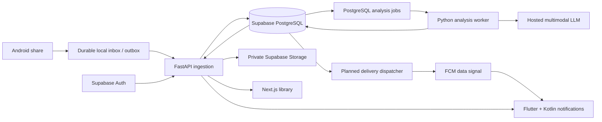

# Architecture

## Status and components

The product flow below is the **target design**. Phase 0 supplies contracts,
migrations, fixture adapters, and scaffolds. [STATUS](STATUS.md) records executed
checks; diagram arrows do not mean integrations are implemented.

| Component | Responsibility | Does not own |
| --- | --- | --- |
| Flutter + Kotlin | Durable receipt, outbox, OS integration, details/editing | Server credentials or inference orchestration |
| Next.js | Synced library and details/editing | Desktop system notifications |
| FastAPI | Authentication, ownership, validation, transactions, wire contract | Inference in the ingestion request |
| Python worker | Extraction, grounded summary, optional recommendations, persistence | User acceptance or workflow completion |
| Supabase | Auth, PostgreSQL, RLS, private objects | UI workflow semantics |
| FCM | Best-effort mobile wake/delivery signal | Authoritative state or permanent event history |

Deploy the web to Vercel and API/worker to Railway only after real adapters and
security checks are complete. No deployment or cloud resources are created in Phase 0.

## Durable ingestion and private assets

The mobile inbox stores the original payload plus a stable idempotency key before
success UI/close. Copy Android temporary content URIs into app-private storage (or
take durable URI permission where supported). A retry reuses the key; independently
sharing the same URL is a new user action with a new key, not global URL deduplication.

Phase A1 publishes an app-private receipt directory containing the source and its
pending outbox record in a single atomic rename. Flutter reads local summaries
through the native bridge. See the [mobile storage details](../apps/mobile/README.md#inbox-and-outbox).

Phase A2 keeps the original and adds an account-bound outbox sidecar. WorkManager
delivers assigned shares under the matching Supabase session. Asset checkpoints
and the acknowledged content ID are saved before advancing the local state.
See the [outbox decision](decisions/0004-mobile-outbox-and-account-binding.md).

For images/documents, use the upload contract in OpenAPI: authenticated initiation,
server-selected owner-prefixed object path and expiring upload capability, upload,
then authenticated completion with server-side object verification. Only completed,
owned assets can be attached. No public bucket or permanent public URL. The adapter
must verify actual size, MIME signature, and checksum, and reject replaced, missing,
cross-owner or already-bound assets as specified. Expiring authenticated read
capabilities are issued only after an ownership check. Treat capability URLs as secrets.

One server transaction must commit the content, asset relationships, initial
notification state, analysis job, sync event, and idempotency receipt. A response
means the transaction committed; inference never runs inside that transaction.
Replay of the same scoped key/body returns the original receipt. Reuse with a
different payload returns a structured conflict. Database uniqueness, transaction
locking, and recorded receipts are required in the real adapter; in-memory tests
only demonstrate semantics, not crash durability or multi-process concurrency.

## Storage model and authorization

The exact physical schema lives in `supabase/migrations/`; API nested documents are
assembled by the repository adapter and are not expected to equal SQL row shape.

| Table / object | Purpose | Access boundary |
| --- | --- | --- |
| preferences | Explicit preferences, initial survey signals | Owner reads; API validates writes |
| contents | Immutable input, user edits, workflow and analysis status | Owner reads; API/worker writes |
| analyses | Generated summary, source coverage, limitations | Owner reads through content ownership; worker writes |
| recommendations | Generated suggestion, separate user edit/acceptance | Owner reads; API/worker writes |
| feedback_events | Explicit feedback with retry identity | Owner reads; API inserts |
| notification_states | Visibility, generation, revision | Owner reads; API transition logic writes |
| analysis_jobs | Queue, leases/retries, processing state | Server-only |
| sync_events / sync_heads | Owner-scoped ordered change stream | Owner event reads; server allocates/writes; heads server-only |
| client_devices | Owner/device registration and delivery metadata | Server-only sensitive device data |
| content_assets | Private object metadata, upload completion, attachment | Owner reads; server writes |
| idempotency_records | Scoped payload hash and original response | Server-only |
| storage.objects | Binary originals in private bucket | Owner/path policy; signed operations via trusted API |

Every owned relation has an explicit `user_id`. Composite foreign keys preserve
ownership across related rows, not just at the top-level content. Sync entity/parent
IDs deliberately have no FK so tombstones survive deletion; the server must check
their ownership before emission. RLS limits
ordinary authenticated reads to the owner. Direct client writes are denied so they
cannot bypass versions, create arbitrary AI results, or rewrite notification state.
Privileged server access bypasses RLS: **the API must still check ownership on every
operation**. Never trust a request's owner field or allow an arbitrary object path.

Supabase access tokens require signature, issuer, audience, expiry, and subject
validation. The server derives the owner from the verified subject. Missing/invalid
credentials are unauthorized; cross-owner identifiers are not found to avoid
enumeration. Phase 0 fixture tokens are local demo tokens only. The production
scaffold fails closed until the real adapter is implemented.

## Analysis pipeline and jobs

Separate steps: ingestion -> extraction -> summarization -> recommendation ->
persistence. Preserve the original source throughout. Coverage explicitly states
full text, partial text, metadata only, or unsupported. Recommendations can be empty.
Persist failures/limitations and retain originals. Provider output is untrusted:
validate schemas and source references before saving, and never execute source text
as instructions, code, or automatic user actions.

The planned PostgreSQL worker claims jobs using leases and `FOR UPDATE SKIP LOCKED`,
commits the claim, performs slow inference outside the transaction, then commits
results with a lease/attempt guard. Retries must not duplicate generated rows or
notify twice. Exponential backoff, finite retry budgets, stale-lease recovery, and
operational monitoring are future work. Failure is a terminal analysis outcome
until an explicit retry policy acts; it does not change workflow or visibility.

Before URL fetching, the real extractor must enforce network restrictions against
SSRF (including redirects/private addresses), byte/time limits, content-type checks,
and safe document handling. These defenses are prerequisites for live extraction,
not capabilities claimed by Phase 0.

## Versions and synchronization

Use UUID resource identifiers, UTC ISO 8601 timestamps, and bearer authentication.
PATCH operations require `expected_version`; mismatch returns HTTP 409 with current
version information. Clients refetch and offer a deliberate merge/retry instead of
silently overwriting another edit. Notification state uses its own generation/revision.

List and sync endpoints use opaque bounded cursors, specified in OpenAPI. Never
derive order from client clocks. The DB design allocates per-owner sync sequences
under an owner-row lock in the same mutation transaction: bare global bigserial
values can commit out of order and skip events. Persist cursor advancement only
after applying the complete received page locally. The real adapter must implement
bootstrap/full resync, cursor retention expiry, and reconnection behavior before
production. Invalid or expired cursors return a structured `invalid_cursor` error;
clients discard the cursor and perform a full resync.
FCM is a hint to fetch authoritative state, not the sync cursor source.

Phase A4 uses the existing owner-scoped content list for the Android library.
Kotlin sends paginated requests with the A2 session and checks ownership
before returning content. Flutter keeps the fetched pages in memory for the
active account and merges them with local receipts by acknowledged server ID.
Device receipts remain available during offline launches. The sample catalog
has a separate route. Catalog reads and edits leave native notification
eligibility tied to acknowledged receipts on this device.

## Notification lifecycle

Creation establishes active generation 1, revision 1. Revisions track changes
within/around state transitions; generations identify explicit presentation lifetimes.
An ordinary AI result can update content and the existing active notification but
cannot change dismissed visibility. Dismissal reports the observed generation;
events from an older generation are ignored, even if delivered after restoration.
Restoration is an explicit version-checked user operation that increments generation
and revision. Replay of its idempotency key cannot create another generation.

Persist local suppression before sending an offline dismissal. A pending local
dismissal suppresses old FCM/sync updates until reconciled. Merge server events by
generation/revision and treat FCM as a refresh hint. Android uses a stable,
account-scoped tag containing the content UUID and a fixed integer ID. Updates
use `onlyAlertOnce`.
The body opens details, with Edit as the sole quick action. Workflow updates are
independent. Device loss, permission denial, and delayed FCM do not lose library data.

Phase A3 connects acknowledged A2 content IDs to native Android presentation.
A private per-owner record stores the last server state, local suppression,
generation issuance and pending event keys. Unique connected-network
WorkManager jobs fetch the current content and send versioned mutations with
the existing Supabase session. Android navigation verifies the active account
and acknowledged ID before exposing details or the title and notes editor.
The mock path exercises the same requests. See the
[Android presentation ADR](decisions/0005-android-notification-presentation.md).

Multi-device delivery eligibility and durable notification dispatch/outbox remain
open server design work. Restoration remains an explicit user choice.

## References used for implementation constraints

- [Supabase private buckets](https://supabase.com/docs/guides/storage/buckets/fundamentals): private download requires authenticated access or a temporary signed URL.
- [Supabase access control](https://supabase.com/docs/guides/storage/security/access-control): service keys bypass RLS and must remain server-side.
- [FastAPI testing](https://fastapi.tiangolo.com/tutorial/testing/): TestClient provides executable API contract checks.
