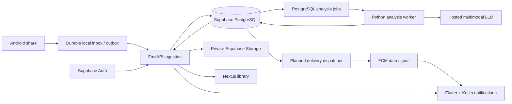

# Architecture

## Status and components

The diagram shows the target product flow. [STATUS](STATUS.md) records
implemented adapters, local integration results, and the separate deployment and
device acceptance milestones.

| Component | Responsibility | Does not own |
| --- | --- | --- |
| Flutter + Kotlin | Durable receipt, outbox, OS integration, details/editing | Server credentials or inference orchestration |
| Next.js | Synced library and details/editing | Desktop system notifications |
| FastAPI | Authentication, ownership, validation, transactions, wire contract | Inference in the ingestion request |
| Python worker | Extraction, grounded summary, optional recommendations, persistence | User acceptance or workflow completion |
| Supabase | Auth, PostgreSQL, RLS, private objects | UI workflow semantics |
| FCM | Best-effort mobile wake/delivery signal | Authoritative state or permanent event history |

A public Vercel demo can serve the checked-in synthetic catalog in fixture mode.
Deploy the authenticated web library to Vercel and API/worker to Railway after
the live integration and security checks are complete.

## Durable ingestion and private assets

The mobile inbox stores the original payload plus a stable idempotency key before
success UI/close. Copy Android temporary content URIs into app-private storage (or
take durable URI permission where supported). A retry reuses the key; independently
sharing the same URL is a new user action with a new key, not global URL deduplication.

Phase A1 publishes an app-private receipt directory containing the source and its
pending outbox record in a single atomic rename. Flutter reads local summaries
through the native bridge. See the [mobile storage details](../apps/mobile/README.md#inbox-and-outbox).

Phase A2 keeps the original and adds an account-bound outbox sidecar. WorkManager
delivers assigned shares under the matching Supabase session. Asset checkpoints
and the acknowledged content ID are saved before advancing the local state.
See the [outbox decision](decisions/0004-mobile-outbox-and-account-binding.md).

Phase A6 uses a separate debug installation for staging. Its package, data
directory and API realm isolate its test data. Stage and live transports
require HTTPS and use the existing session client.
[Android staging decision](decisions/0007-android-staging-environment.md)

For images and documents, the upload contract starts with authenticated
reservation. FastAPI selects the owner-prefixed object path and issues a
path-scoped Supabase PUT capability with overwrite disabled. The replay record
for the reservation is server-only. Completion verifies the private object's
actual size, media type, and SHA-256. Image verification includes decoding.
The content transaction attaches ready assets owned by the caller once.
Owner-checked download URLs expire within 60 seconds. Keep capability URLs out
of logs, content, and sync events.

One server transaction must commit the content, asset relationships, initial
notification state, analysis job, sync event, and idempotency receipt. A response
means the transaction committed; inference never runs inside that transaction.
Replay of the same scoped key/body returns the original receipt. Reuse with a
different payload returns a structured conflict. Database uniqueness, transaction
locking, and recorded receipts are required in the real adapter; in-memory tests
only demonstrate semantics, not crash durability or multi-process concurrency.

## Storage model and authorization

The exact physical schema lives in `supabase/migrations/`; API nested documents are
assembled by the repository adapter and are not expected to equal SQL row shape.

| Table / object | Purpose | Access boundary |
| --- | --- | --- |
| preferences | Explicit preferences, initial survey signals | Owner reads; API validates writes |
| contents | Immutable input, user edits, workflow and analysis status | Owner reads; API/worker writes |
| analyses | Generated summary, source coverage, limitations | Owner reads through content ownership; worker writes |
| recommendations | Generated suggestion, separate user edit/acceptance | Owner reads; API/worker writes |
| feedback_events | Explicit feedback with retry identity | Owner reads; API inserts |
| notification_states | Visibility, generation, revision | Owner reads; API transition logic writes |
| analysis_jobs | Queue, leases/retries, processing state | Server-only |
| sync_events / sync_heads | Owner-scoped ordered change stream | Owner event reads; server allocates/writes; heads server-only |
| client_devices | Owner/device registration and delivery metadata | Server-only sensitive device data |
| content_assets | Private object metadata, upload completion, attachment | Owner reads; server writes |
| idempotency_records | Scoped payload hash and original response | Server-only |
| storage.objects | Binary originals in private bucket | Owner/path policy; signed operations via trusted API |

Every owned relation has an explicit `user_id`. Composite foreign keys preserve
ownership across related rows, not just at the top-level content. Sync entity/parent
IDs deliberately have no FK so tombstones survive deletion; the server must check
their ownership before emission. RLS limits
ordinary authenticated reads to the owner. Direct client writes are denied so they
cannot bypass versions, create arbitrary AI results, or rewrite notification state.
Privileged server access bypasses RLS: **the API must still check ownership on every
operation**. Never trust a request's owner field or allow an arbitrary object path.

Supabase access tokens require signature, issuer, audience, expiry, and subject
validation. The server derives the owner from the verified subject. Missing/invalid
credentials are unauthorized; cross-owner identifiers are not found to avoid
enumeration. Production verifies the configured Supabase signing realm before
any owner-scoped PostgreSQL access. Fixture tokens are local demo identities.

## Analysis pipeline and jobs

Separate steps: ingestion -> extraction -> summarization -> recommendation ->
persistence. Preserve the original source throughout. Coverage explicitly states
full text, partial text, metadata only, or unsupported. Recommendations can be empty.
Persist failures/limitations and retain originals. Provider output is untrusted:
validate schemas and source references before saving, and never execute source text
as instructions, code, or automatic user actions.

The PostgreSQL worker acquires the owner sync lock before row locks and claims
jobs with `FOR UPDATE SKIP LOCKED`. Analysis runs after the claim commits. The
result transaction checks the owner lock, worker, attempt and lease expiry.
Status changes and their sync events commit together. A published result or
terminal failure advances the content version. The worker currently
allows three attempts with a 30-second retry delay and recovers 10-minute-old
leases. Workflow and notification state remain independent of analysis.

URL jobs resolve each destination and connect directly to a vetted public
address with the original HTTP authority and TLS name. Redirects are checked
before connecting. The fetch uses standard web ports, honors the site's
robots rules and access restrictions, and bounds time and response bytes.
The parser extracts accessible title and body text. The worker passes that
text as untrusted data to the supplied-text analyzer and keeps the saved URL and
caption as the original source.

Image jobs look up ready assets by both content and owner. The worker reads
and verifies the private objects before passing image bytes to the configured
vision analyzer. Request-size or frame limitations are recorded in the
analysis. Generated results use the existing summary and recommendation
categories. Missing access or analyzer credentials produce an explicit
limitation, and terminal failure preserves the original and user edits.

## Versions and synchronization

Use UUID resource identifiers, UTC ISO 8601 timestamps, and bearer authentication.
PATCH operations require `expected_version`; mismatch returns HTTP 409 with current
version information. Clients refetch and offer a deliberate merge/retry instead of
silently overwriting another edit. Notification state uses its own generation/revision.

List and sync endpoints use opaque bounded cursors, specified in OpenAPI. Never
derive order from client clocks. The DB design allocates per-owner sync sequences
under an owner-row lock in the same mutation transaction: bare global bigserial
values can commit out of order and skip events. Persist cursor advancement with
the complete received page. The production sync adapter signs each account
checkpoint and returns retained events from a cursorless start. Invalid
checkpoints return HTTP 400 `invalid_cursor`. FCM can signal that authoritative
state should be fetched.

Phase A5 stores content, preferences, tombstones and the sync checkpoint in
SQLite per API realm and authenticated user. The worker applies each feed page
in one transaction. Initial sync or cursor expiry stages a full catalog between
a feed boundary and a catch-up pass, then atomically publishes it. Flutter
reads the snapshot offline and merges it with A1/A2 originals by acknowledged
server ID. A server tombstone can hide the card without deleting the original.
The sample catalog has a separate route.

WorkManager coalesces connected sync jobs after authentication, launch/resume,
explicit refresh, reconnection and upload acknowledgment. A cached snapshot is
a read-only fallback until an authoritative detail fetch. Affected acknowledged
items may trigger the existing A3 refresh path, which uses a fresh authorized
read and checks durable suppression. See the
[Android sync ADR](decisions/0006-android-library-sync-checkpoints.md).

## Notification lifecycle

Creation establishes active generation 1, revision 1. Revisions track changes
within/around state transitions; generations identify explicit presentation lifetimes.
An ordinary AI result can update content and the existing active notification but
cannot change dismissed visibility. Dismissal reports the observed generation;
events from an older generation are ignored, even if delivered after restoration.
Restoration is an explicit version-checked user operation that increments generation
and revision. Replay of its idempotency key cannot create another generation.

Persist local suppression before sending an offline dismissal. A pending local
dismissal suppresses old FCM/sync updates until reconciled. Merge server events by
generation/revision and treat FCM as a refresh hint. Android uses a stable,
account-scoped tag containing the content UUID and a fixed integer ID. Updates
use `onlyAlertOnce`.
The body opens details, with Edit as the sole quick action. Workflow updates are
independent. Device loss, permission denial, and delayed FCM do not lose library data.

Phase A3 connects acknowledged A2 content IDs to native Android presentation.
A private per-owner record stores the last server state, local suppression,
generation issuance and pending event keys. Unique connected-network
WorkManager jobs fetch the current content and send versioned mutations with
the existing Supabase session. Android navigation verifies the active account
and acknowledged ID before exposing details or the title and notes editor.
The mock path exercises the same requests. See the
[Android presentation ADR](decisions/0005-android-notification-presentation.md).

Multi-device delivery eligibility and durable notification dispatch/outbox remain
open server design work. Restoration remains an explicit user choice.

## References used for implementation constraints

- [Supabase private buckets](https://supabase.com/docs/guides/storage/buckets/fundamentals): private download requires authenticated access or a temporary signed URL.
- [Supabase access control](https://supabase.com/docs/guides/storage/security/access-control): service keys bypass RLS and must remain server-side.
- [FastAPI testing](https://fastapi.tiangolo.com/tutorial/testing/): TestClient provides executable API contract checks.
